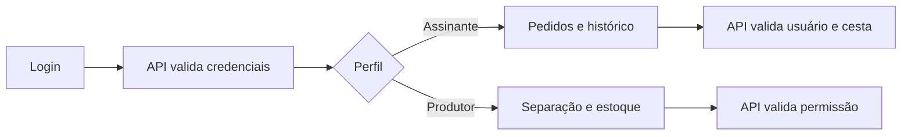

# Fluxos do sistema — Cesta do Vale

Descrição do checkout de referência de 24/11/2026. Consulte o [roadmap](../../ROADMAP_ARQUITETURA.md) para ver as conexões entre as camadas.

## 1. Fluxo de acesso

1. A pessoa abre a tela de acesso da landing. O cadastro público cria uma conta de assinante, com confirmação opcional de e-mail.
2. No login informa usuário ou e-mail e senha. Quem esqueceu a senha pode pedir um link de recuperação de uso único.
3. A API autentica e identifica o perfil. A assinante pode criar e acompanhar cestas. O produtor tem acesso à separação e ao catálogo conforme as permissões.
4. As rotas protegidas validam a sessão, o perfil e, quando aplicável, a propriedade do registro.

## 2. Fluxo da assinante — criar pedido

1. Aline acessa **Pedir a cesta**.
2. Escolhe o tamanho da cesta.
3. Escolhe uma cesta pronta ou seleciona os produtos.
4. O sistema valida limite, estoque e quantidades.
5. Aline revisa a composição.
6. Confirma o pedido.
7. A cesta é criada como pendente e aparece no histórico.

## 3. Fluxo da assinante — acompanhar pedido

1. Aline abre o histórico.
2. Seleciona uma cesta.
3. Consulta produtos, quantidades e situação.
4. Se estiver pendente, pode cancelar.
5. Após o envio, recebe um aviso e pode confirmar o recebimento. A avaliação é liberada após a entrega.

## 4. Fluxo do produtor — separar pedido

1. Vanderlei abre a área de separação.
2. Consulta as cestas pendentes.
3. Abre uma cesta.
4. Registra os produtos separados, individualmente ou em lote.
5. Pode ajustar ou desfazer quantidades registradas.
6. Ao concluir a separação ou encerrá-la com faltantes, a cesta fica **Preparado para envio**.
7. Ao marcar a cesta como enviada, a API registra o envio e persiste a notificação para a assinante.

## 5. Fluxo de autorização

## 6. Referências

- [`DIAGRAMA_GRUPOS.html`](DIAGRAMA_GRUPOS.html)
- [`../PASSO_A_PASSO_PROJETO.md`](../PASSO_A_PASSO_PROJETO.md)
- Telas em `frontend/src/componentes/`.
- [Flora, consultas e confirmação](../../FLORA_FLUXO_POSSIBILIDADES_E_TESTES.md).
