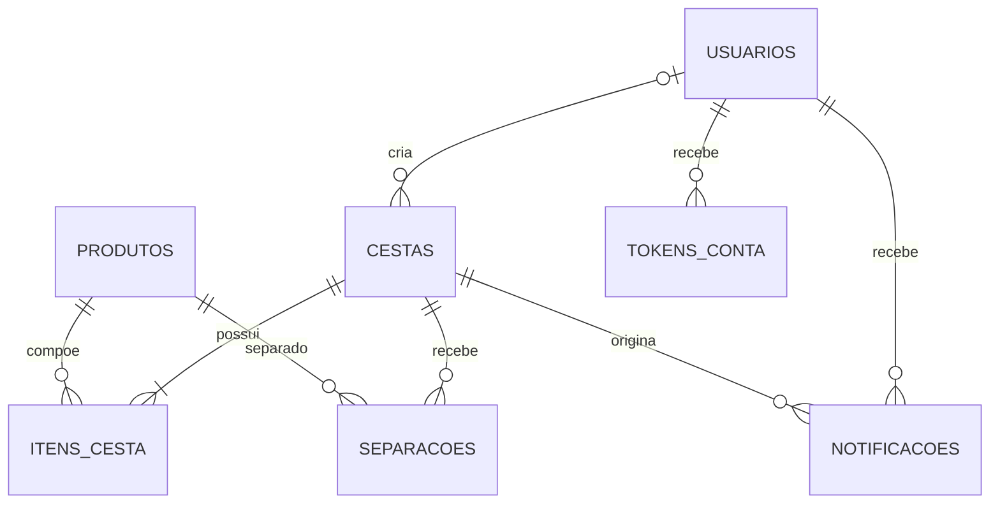

# Banco de dados — Cesta do Vale

## 1. Configuração

A conexão é centralizada em `backend/banco.py` na origem. O projeto usa SQLite para desenvolvimento, MySQL no Compose e PostgreSQL/Supabase conforme o ambiente. [Roadmap e topologia](../../ROADMAP_ARQUITETURA.md)

## 2. Entidades

| Tabela | Finalidade |
|---|---|
| `usuarios` | Contas, credenciais e perfil de acesso. |
| `produtos` | Catálogo e estoque disponível. |
| `cestas` | Pedido principal, estado, marcos de separação e envio, avaliações por perfil. |
| `itens_cesta` | Produtos, quantidades e preço unitário registrado na criação. |
| `separacoes` | Quantidades já separadas pelo produtor. |
| `tokens_conta` | Hashes de tokens de uso único para confirmação e recuperação. |
| `notificacoes` | Avisos persistidos ligados à conta e à cesta. |

## 3. Relacionamentos

## 4. Regras de integridade

- `cestas.usuario_id` referencia `usuarios.id` e aceita nulo para compatibilidade com registros antigos.
- `itens_cesta.cesta_id` referencia `cestas.id` com exclusão em cascata.
- `itens_cesta.produto_id` referencia `produtos.id`.
- `separacoes.cesta_id` referencia `cestas.id` com exclusão em cascata.
- Uma cesta não pode repetir o mesmo produto em `itens_cesta`.
- Uma cesta não pode repetir o mesmo produto em `separacoes`.

## 5. Migrações

Na origem, o Alembic versiona as mudanças em `backend/migracoes/versions/`, com revisão `20261107_0015` nesta base. Os modelos SQLAlchemy ficam em `backend/modelos/`. Valide a cadeia no banco escolhido e verifique as políticas de acesso no ambiente de destino.

## 6. Diagrama complementar

O diagrama visual de grupos, rotas, permissões e banco está em [`DIAGRAMA_GRUPOS.html`](DIAGRAMA_GRUPOS.html).
