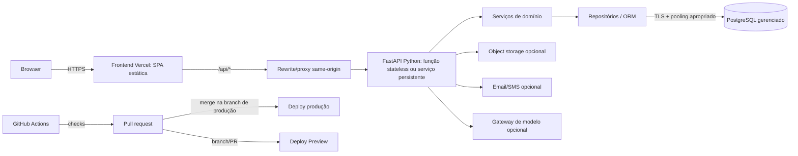

# Especificação técnica de implementação de novo sistema web

**Tipo:** especificação normativa para execução assistida por LLM/agentes de código  
**Escopo:** ciclo de vida completo, da ideia ao deploy e operação  
**Referência:** stack e topologia documentadas do Cesta do Vale  
**Revisão:** 24/11/2026

> Este documento é uma especificação de engenharia. Use-o como entrada de implementação por fases. Os valores marcados `DECIDIR` precisam ser definidos para o novo produto antes de gerar código dependente. A stack de referência é um perfil inicial, não uma decisão universal.

## 0. Instruções de execução para LLM

### 0.1 Papel e limites do agente

Você é um agente de implementação de software. Deve transformar o briefing aprovado em um sistema executável, verificável e implantável. Trabalhe em incrementos pequenos, preserve a rastreabilidade requisito → componente → contrato → teste → evidência e mantenha as decisões técnicas registradas.

Regras obrigatórias:

1. Inspecione o repositório e as instruções locais (`AGENTS.md`, `README.md`, workflows e manifests) antes de alterar arquivos.
2. Não invente requisitos, domínios, perfis, conteúdo, segredos, endpoints de terceiros, custos ou credenciais. Marque lacunas como `DECIDIR` e avance apenas no trabalho independente.
3. Não copie regras de negócio ou dados do Cesta do Vale para outro domínio. Use `02_REFERENCIAS/` apenas para aprender padrões e configuração.
4. Não introduza framework, serviço externo, pacote, agente autônomo ou banco adicional sem justificar a necessidade e atualizar a decisão arquitetural.
5. Não coloque chaves privadas, dados reais, tokens, arquivos `.env`, dumps ou conteúdo interno no Git, no bundle do frontend, nos logs ou em prompts enviados a terceiros.
6. Não declare testes, build, deploy, migração, backup ou verificação como concluídos sem executar e registrar a evidência.
7. Antes de iniciar cada fase, leia as entradas obrigatórias da fase. Ao final, produza os artefatos e a lista de critérios de aceite com status `PASS`, `FAIL` ou `BLOCKED` e evidências concretas.
8. Se um requisito contradiz segurança, integridade dos dados ou os contratos aprovados, pare a etapa dependente, documente a contradição e proponha uma decisão explícita.
9. Use versões suportadas e compatíveis no momento da implementação. Consulte documentação oficial atualizada antes de fixar major versions ou configurações de plataforma. Registre data, URL e versão consultadas.
10. Faça mudanças apenas no escopo autorizado. Deploy de produção, alteração destrutiva de dados e publicação externa exigem autorização explícita do responsável pelo projeto.

### 0.2 Formato de saída esperado em cada fase

```yaml
fase: "Fxx"
status: "PASS | FAIL | BLOCKED"
decisoes:
  - id: "ADR-001"
    resumo: "..."
artefatos:
  - caminho: "..."
    finalidade: "..."
verificacoes:
  - comando: "..."
    resultado: "..."
    evidencia: "..."
pendencias:
  - "..."
proxima_fase: "Fxx"
```

Não avance quando um critério obrigatório estiver `FAIL` ou `BLOCKED`. Itens opcionais só podem ser omitidos depois de registrar `NOT_APPLICABLE` e a justificativa.

## 1. Contrato de entrada do novo produto

Antes de implementar, preencher `docs/product/brief.md` com os campos abaixo. Nenhum valor deste modelo deve ser presumido a partir do site de referência.

```yaml
product:
  name: "DECIDIR"
  problem: "DECIDIR"
  measurable_outcome: "DECIDIR"
  target_users: []
  primary_journey: "DECIDIR"
  launch_scope: []
  out_of_scope: []
domain:
  entities: []
  invariants: []
  state_machines: []
identity:
  public_signup: "DECIDIR"
  roles: []
  session_strategy: "DECIDIR"
data:
  personal_or_sensitive_data: []
  retention_policy: "DECIDIR"
  deletion_policy: "DECIDIR"
integrations:
  llm_required: false
  external_services: []
quality:
  availability_target: "DECIDIR"
  performance_targets: "DECIDIR"
  accessibility_target: "DECIDIR"
  recovery_targets: "DECIDIR"
delivery:
  environments: [local, preview, production]
  production_branch: "DECIDIR"
  owner: "DECIDIR"
```

**Saída obrigatória:** problema observável, métrica de sucesso, perfis, jornada principal, limites do MVP, entidades/regras, dados tratados, integrações, metas operacionais e responsável por produção. Requisitos devem ser numerados (`REQ-F-###`, `REQ-NF-###`) e ter critério de aceite mensurável.

## 2. Perfil tecnológico de referência e regras de escolha

### 2.1 Perfil padrão compatível com o exemplo técnico

| Camada | Padrão de referência | Uso e motivo | Condição para escolher alternativa |
| --- | --- | --- | --- |
| Linguagem frontend | JavaScript ES Modules; TypeScript é recomendado para projeto novo com domínio e contratos crescentes | Mantém código web no ecossistema npm; TypeScript detecta incompatibilidades entre componentes e modelos em build | Use JavaScript para protótipo pequeno/equipe já especializada; decida antes da implementação e mantenha uma linguagem principal por camada |
| UI | React | Componentes reutilizáveis e ecossistema amplo; usado na referência | Escolha Vue/Svelte/Angular quando experiência da equipe, design system ou requisito existente justificar |
| Ferramenta frontend | Vite | Dev server e build de assets estáticos para SPA; rápido e compatível com deploy estático na Vercel | Escolha Next.js quando SSR/SSG, rotas server-side, metadata por página ou renderização híbrida for requisito; não adicione SSR sem necessidade |
| Backend | Python 3.x + FastAPI + Pydantic | API HTTP tipada, validação de dados, OpenAPI e boa adequação às integrações/IA do exemplo | Use Django para admin e domínio CRUD integrado; Node.js/TypeScript com NestJS/Fastify quando a equipe e o runtime forem centrados em TypeScript; escolha Java/.NET quando padrões organizacionais exigirem |
| Persistência | PostgreSQL em produção, SQLAlchemy 2.x + Alembic no perfil Python | Relacional, constraints/transações e migrações explícitas; padrão geral para dados de negócio consistentes | Use MySQL por compatibilidade organizacional; SQLite apenas dev/teste/instalação de baixo volume com restrições claras; NoSQL apenas se o modelo e consultas justificarem documentos/chaves |
| Provedor PostgreSQL | Supabase como opção gerenciada para PostgreSQL, com serviços adicionais opcionais | Reduz operação de infraestrutura do banco e oferece conexão, poolers, painel e CLI para migrations; pode-se usar apenas Postgres sem adotar Supabase Auth, Storage ou Data API | Comparar região, plano, limites de conexão, backup/restore, preço e requisitos de rede; registrar a escolha no ADR |
| Repositório de arquivos | Object storage do provedor com URLs assinadas; `DECIDIR` provedor | Separa binários do banco e permite políticas de acesso | Não usar o filesystem efêmero de função/serverless como persistência |
| Hospedagem web | Vercel para frontend estático e Preview/Production | Deploy por Git, CDN e preview; alinhado à configuração existente | Reavalie se custos, residência de dados, runtime, execução longa ou arquitetura de rede exigirem outro host |
| API Python | Vercel Functions para endpoints curtos/stateless compatíveis; ou container persistente gerenciado | A referência usa projeto Vercel separado; função escala sob demanda | Use container/VM/serviço gerenciado para workers contínuos, conexões persistentes, tarefas longas ou dependências incompatíveis |
| CI | GitHub Actions | Pipeline declarativo no Git, checks em PR e deploy conectado ao provedor | Ajuste ao Git provider escolhido; mantenha os mesmos gates de qualidade e segurança |

**Observação de linguagem:** o projeto de referência atual usa React + Vite em JavaScript/JSX e FastAPI em Python; sua CI configura Node 22 e Python 3.12. O pacote declarado pelo backend e a imagem/container devem ser conferidos separadamente: a versão da CI não prova a versão implantada. Para um projeto novo, escolha e fixe as versões suportadas em todos os ambientes. Não misture essa referência com uma afirmação de que TypeScript já é usado nela.

### 2.2 Árvore de decisão da arquitetura

```text
Há dados persistentes, identidade, regra de domínio ou integração privada?
├─ Não → site estático (React/Vite ou alternativa); sem API/banco; conteúdo versionado ou CMS.
└─ Sim
   ├─ Precisa renderização no servidor/SEO por conteúdo dinâmico?
   │  ├─ Sim → avaliar Next.js/SSR ou frontend + API independente.
   │  └─ Não → SPA React/Vite + API HTTP independente.
   ├─ Relações, transações, histórico ou autorização por registro?
   │  ├─ Sim → PostgreSQL gerenciado como padrão; schema, migrations e backups.
   │  └─ Não → documentar consultas e comparar relacional vs. documento/chave-valor.
   ├─ API executa somente requisições curtas e sem estado local?
   │  ├─ Sim → Vercel Function Python/Node ou runtime serverless equivalente.
   │  └─ Não → serviço de container/worker persistente e fila para tarefas assíncronas.
   └─ IA altera ou sugere dados de negócio?
      ├─ Sim → API/serviço de IA no servidor; output tipado; validação de domínio; confirmação explícita.
      └─ Não → não instalar SDK nem enviar dados a um LLM.
```

### 2.3 ADRs obrigatórios

Crie `docs/architecture/decisions/ADR-NNN-titulo.md` com: status, contexto, decisão, alternativas, critérios, consequências, custo/risco, data, responsável e documentação consultada. ADRs mínimos:

- framework/language frontend e necessidade de SSR;
- backend e tipo de runtime (função vs. processo persistente);
- banco, hospedagem, região, pooling, migração e backup;
- identidade/sessão e política de autorização;
- CI/CD, ambientes e fluxo de release;
- LLM/provedor/agentes, caso aplicável;
- observabilidade, retenção e recuperação.

## 3. Arquitetura lógica e estrutura de repositório

### 3.1 Topologia padrão



Frontend nunca recebe credencial de banco, chave de LLM, token SMTP ou chave privada. O browser comunica-se com endpoints públicos do backend via HTTPS. Todas as operações com efeito de negócio são autorizadas e validadas pelo servidor.

### 3.2 Layout de referência

```text
novo-sistema/
├── AGENTS.md                       # Instruções concisas para agentes de código
├── README.md                       # Setup, comandos, ambientes e runbook
├── .env.example                    # Nomes e valores não secretos/fictícios
├── .gitignore
├── .github/workflows/ci.yml
├── docs/
│   ├── product/brief.md
│   ├── product/requirements.md
│   ├── product/user-flows.md
│   ├── architecture/system-context.md
│   ├── architecture/data-model.md
│   ├── architecture/api-contract.yaml
│   ├── architecture/threat-model.md
│   ├── architecture/runbook.md
│   └── architecture/decisions/ADR-*.md
├── frontend/
│   ├── package.json
│   ├── package-lock.json
│   ├── vercel.json
│   ├── src/{app,features,components,lib,api}/
│   └── tests/{unit,e2e}/
├── backend/
│   ├── pyproject.toml ou requirements*.txt
│   ├── requirements.txt           # Dependências/runtime Python, com resolução fixada
│   ├── requirements-dev.txt       # Ferramentas/testes Python, incluindo runtime
│   ├── main.py
│   ├── app/{api,core,domain,services,repositories,schemas}/
│   ├── migrations/                 # Alembic se SQLAlchemy
│   └── tests/{unit,integration}/
└── infra/                          # IaC/scripts apenas quando aprovados
```

Monorepo não obriga um único deploy. Na Vercel, configure projeto frontend com Root Directory `frontend`; configure API separadamente com Root Directory `backend` quando usar Functions Python. Defina explicitamente escopo e caminhos do build para evitar que documentação interna ou artefatos privados entrem na saída pública.

## 4. Sequência de implementação: ideia a produção

Cada fase tem entrada, ações, saída, gates e evidência. Ordem padrão; dependências opcionais são marcadas.

### F00 — Ideia, escopo e requisitos

**Entrada:** problema e contexto fornecidos pelo responsável.  
**Ações:** converter ideia em problema verificável; identificar usuários, jornada principal, alternativas existentes, valor esperado, escopo MVP, exclusões, hipóteses e riscos; numerar requisitos funcionais e não funcionais; distinguir requisito, preferência e hipótese.  
**Saída:** `docs/product/brief.md`, `requirements.md`, mapa de jornadas e glossário.  
**Gate:** jornada principal pode ser descrita em passos e resultado mensurável; cada requisito tem prioridade e critério de aceite; não há regra de domínio inferida pelo agente.

### F01 — UX, rotas e contrato de interface

Definir sitemap, rotas, perfis autorizados, estados `loading/empty/error/success`, validações, acessibilidade, responsividade, conteúdo e eventos analíticos aprovados. Prototipar jornada principal em viewport móvel e desktop. Mapear requisitos para telas e componentes. Não iniciar páginas desconectadas do fluxo aprovado.

**Saída:** `docs/product/user-flows.md`, inventário de telas/rotas, wireframes e tokens visuais iniciais.  
**Gate:** toda jornada requerida tem caminho feliz, falhas recuperáveis e critério de conclusão; textos não prometem funcionalidades inexistentes.

### F02 — ADR, modelo de ameaça e blueprint

1. Aplicar árvore da seção 2.2; registrar ADRs e justificar stack, banco, runtime e provedores.
2. Desenhar contexto, containers, fronteiras de confiança, fluxo de dados e sequência da jornada crítica.
3. Elaborar modelo de ameaças: abuso de endpoints, autorização por objeto, enumeração, injeção, CSRF/XSS, SSRF, abuso de upload, prompt injection, vazamento em logs, dependência comprometida e indisponibilidade do provedor.
4. Classificar dados e definir mínimo necessário, retenção, exclusão, backup, criptografia e acesso operacional.

**Saída:** `system-context.md`, `data-model.md`, `threat-model.md`, ADRs e `api-contract.yaml` preliminar (OpenAPI ou equivalente).  
**Gate:** cada dado tem fonte, finalidade, classificação, acesso e prazo; cada operação de escrita tem autorização e invariantes definidos.

### F03 — Fundações, monorepo e ambientes

Configurar manifests de dependências com resolução reproduzível, lint, format, testes mínimos, CI, `.gitignore`, `.dockerignore` se Docker for adotado, `.env.example`, README e `AGENTS.md`. Fixar versões de runtimes e reproduzir localmente. Criar config tipada no backend com falha rápida para variáveis obrigatórias ausentes. Nunca versionar `.env` real.

**Contrato obrigatório de dependências:** no frontend, versionar `package.json` e `package-lock.json`; usar `npm ci` na CI e no deploy para instalar exatamente o lockfile. No backend Python, escolher um único padrão antes da implementação: (A) `pyproject.toml` com lockfile gerado pelo gerenciador escolhido; ou (B) `requirements.in`/`requirements-dev.in` como entradas e `requirements.txt`/`requirements-dev.txt` compilados com versões transitivas fixadas. A opção B é mais próxima do Cesta do Vale. `requirements.txt` declara pacotes Python de runtime; `requirements-dev.txt` acrescenta pytest, lint e ferramentas de desenvolvimento, sem substituir o runtime. Registre a versão do gerenciador e o comando de atualização. CI/produção instalam arquivos resolvidos, nunca atualizam dependências implicitamente. Restrições como `>=` sozinhas não são lockfile. Não misturar pip/requirements com Poetry/uv sem uma fonte de verdade explícita.

Manifesto mínimo de runtime Python no perfil de referência (ajustar versões após compatibilidade e revisão de segurança; exemplo de nomes, não copiar pins desatualizados):

```text
fastapi
uvicorn
pydantic
SQLAlchemy
alembic
psycopg[binary]
```

Adicionar biblioteca apenas quando código aprovado a importar. Drivers MySQL, bibliotecas de LLM, SMTP e SDKs Supabase são dependências condicionais. Se a aplicação só usa PostgreSQL via SQLAlchemy, não instalar `supabase-py` sem utilizar Auth, Storage, Data API ou outro serviço do SDK.

**Comandos ilustrativos (adaptar às versões e gerenciador escolhidos):**

```bash
# Frontend React + Vite: diretório frontend
npm create vite@latest frontend -- --template react-ts
cd frontend && npm install
npm run dev

# Backend Python: usar versão fixada no projeto e ambiente isolado
python -m venv .venv
# ativação depende do sistema operacional
python -m pip install fastapi uvicorn sqlalchemy alembic psycopg[binary] pydantic-settings
```

Esses comandos são bootstrap, não especificação de versões. Para builds reproduzíveis, revisar dependências, gravar lockfile/resolution e preferir `npm ci` e instalação Python por lock/constraints aprovados. Não execute `latest` como versão de produção sem fixar e registrar a resolução.

**Gate:** clone limpo instala dependências e executa app, lint, testes e build com instruções documentadas; CI roda em Pull Request.

### F04 — Persistência, migrações e contratos da API

**Banco padrão com dados relacionais:** PostgreSQL gerenciado. Motivos: constraints, transações ACID, índices, integridade referencial, migrações, consultas e ferramentas consolidadas. Supabase é uma opção de PostgreSQL gerenciado (inclui serviços adicionais opcionais); não implica usar Auth/Data API do Supabase. Se usar ORM SQLAlchemy, definir limites claros para modelo, transação e sessão.

#### Perfil Supabase + FastAPI/SQLAlchemy

Use este perfil quando o ADR escolher Supabase como serviço de PostgreSQL. Separe projetos de banco para desenvolvimento/testes e produção; Preview nunca deve apontar para o banco de produção. Escolha região compatível com usuários, backend e requisitos de dados. Credenciais vêm do painel **Connect** do projeto; não derive hostname, usuário de pooler nem porta de memória, pois variam por projeto e modo.

**Modo A — API como única fronteira de dados (padrão deste guia):** navegador chama FastAPI; somente o backend acessa PostgreSQL por SQLAlchemy/Psycopg. Mantenha URL/senha no segredo `DATABASE_URL` do backend. A API valida identidade, autorização por objeto e regras de domínio. Não habilite acesso cliente direto apenas para simplificar a integração. RLS pode ser uma camada adicional se tabelas forem acessíveis por Data API ou se a conexão da API usar papel limitado sem `BYPASSRLS`; não conte com RLS para restringir uma conexão privilegiada ou papel `service_role`, que contorna políticas.

**Modo B — Cliente Supabase no navegador (alternativa arquitetural):** só adotar com decisão explícita. O browser usa URL do projeto e chave publicável (antes chamada `anon`); nenhuma chave secreta/service role ou senha Postgres entra no bundle. Habilite RLS em todas as tabelas expostas e crie policies `SELECT/INSERT/UPDATE/DELETE` por usuário/tenant; sem policy, acesso deve ser negado. Teste usuário anônimo, usuário autenticado, acesso cruzado a tenant/linha e papéis administrativos. Supabase Auth, Data API, Storage e Realtime são produtos opcionais separados; selecionar cada um no ADR, definir token/claims e mapear autorização.

**Conexão conforme runtime:**

| Ambiente do backend | Conexão recomendada | Regras |
| --- | --- | --- |
| Container/VM persistente com IPv6 ou capacidade IPv4 aprovada | Direta | Pool SQLAlchemy dimensionado para todas as réplicas; direct endpoint pode ser IPv6-only conforme plano/configuração |
| Vercel Function/API serverless e ambientes IPv4 | Shared Pooler, transaction mode (Supavisor; normalmente porta 6543) | Obter URI exata em Connect; limitar conexões locais por instância (a documentação SQLAlchemy da Supabase recomenda `NullPool` para autoscaling/transação); revisar instruções do driver para prepared statements e estado de sessão; não usar features que dependam da sessão entre transações |
| Ferramenta/migração que precise de sessão persistente | Conexão direta ou shared pooler session mode, conforme rede e ferramenta | Executar como etapa controlada, não no cold start de cada função; revisar acesso IPv4/IPv6 e papel usado |

Para shared transaction pooler, conferir requisitos atuais de SQLAlchemy/Psycopg: prepared statements e outros estados de sessão podem não ser suportados. Configurar TLS; `sslmode=require` cifra a conexão, enquanto validação completa do certificado requer configuração CA/`verify-full`. Criar Engine uma vez por processo/função aquecida, sessão SQLAlchemy por requisição e fechar sessão sempre; com `NullPool`, não manter conexões locais ociosas. Não assumir que `pool_size=1` e `NullPool` são intercambiáveis: seguir recomendação atual do provedor/driver selecionado. Monitorar conexões, timeout, latência e erros do pool. Não colocar chave de provedor Supabase no frontend em arquitetura API-only.

**Migrações: escolher uma autoridade única para o schema.** Para API FastAPI + SQLAlchemy, usar Alembic como padrão e conectar a migration job ao endpoint de banco apropriado, com privilégio dedicado; gerar migration, revisar SQL, testar banco vazio e upgrade antes de produção. Supabase CLI é opcional para stack local e gestão de projeto. Se a equipe escolher migrations SQL da Supabase CLI como autoridade (útil para RLS, grants e extensões Supabase), versionar `supabase/config.toml`, `supabase/migrations/*.sql` e seed apenas sintético; executar `supabase start`, `supabase db reset`, revisar migration e testar em banco local. Não deixar Alembic e Supabase CLI gerarem/aplicarem alterações sobrepostas no mesmo schema sem uma estratégia de baseline/histórico aprovada. Para deploy remoto: vincular project-ref correto, revisar `supabase db push --dry-run --remote`, confirmar alvo e aplicar migrations como release controlado; não executar reset destrutivo, seed ou `db push` não revisado em produção. Manter senha do banco e access token da CLI como secrets, nunca em config versionada.

**Checklist de provisionamento Supabase:** (1) aprovar fornecedor, região e orçamento/plano; (2) criar projetos separados por ambiente e guardar project-ref sem segredo; (3) definir papel runtime de privilégio mínimo e papel de migration separado quando suportado pelo desenho; (4) modelar schema, índices, constraints, RLS e migrations; (5) copiar a URI do modo de conexão adequado em Connect; (6) guardar `DATABASE_URL` nos secrets do backend local/Preview/Production, URL diferente para cada ambiente; (7) configurar SSL, timeout e política de pool; (8) aplicar migration inicial em dev e verificar query, readiness e backup; (9) repetir em Preview isolado; (10) promover migration aprovada para produção e verificar smoke test/telemetria. Supabase não substitui autenticação/autorização da API por ser usado como banco.

**Schema:** tabelas, PK/FK, unicidade, `NOT NULL`, checks, índices justificados por consulta, timestamps UTC, estratégia de exclusão, retenção, concorrência e auditoria. Dinheiro usa decimal/inteiro em unidade mínima, não float. Estados do domínio explícitos; invariantes enforced no servidor e, quando possível, também em constraints/transações.

**Migrações:** Alembic cria migração versionada. Inspecionar SQL de upgrade/downgrade e revisar operações destrutivas. Nunca recriar banco de produção para corrigir schema. Fazer backup antes de migração arriscada; definir compatibilidade expand/contract quando código e schema mudarem em releases separados. Migração de produção é job/release controlado, não efeito colateral concorrente do startup de cada função serverless.

**API:** contrato OpenAPI versionado; esquemas request/response; paginação, limites, filtros, erros uniformes, autenticação, autorização por ação e por objeto, CORS mínimo, rate limits e idempotência em mutações sujeitas a retry. Operações transacionais precisam validar leitura/alteração concorrente. Não confiar em IDs ou valores enviados pelo cliente como autorização/preço/estado autoritativo.

**Gate:** instalação em banco vazio e upgrade do schema anterior passam em ambiente descartável; contrato cobre sucesso, validação, não autenticado, proibido, não encontrado, conflito e falha; testes provam isolamento entre usuários.

### F05 — Identidade, sessão e autorização (se aplicável)

Registrar decisão: provedor próprio ou externo; sessão por cookie seguro ou bearer; duração, renovação, expiração, logout e revogação; cadastro, verificação de e-mail, recuperação; MFA quando o risco exigir; papéis e atributos; proteção CSRF se cookies; armazenamento hash Argon2id/scrypt para senhas próprias; limitação de tentativas e mensagens contra enumeração.

Autorização no backend em cada operação e em cada objeto. O frontend oculta ações por UX, mas não é controle de acesso. Não guardar tokens de longa duração em `localStorage`. Cookies de produção devem avaliar `HttpOnly`, `Secure`, `SameSite`, domínio/path e CSRF. Não adotar JWT por padrão sem definir rotação, revogação e gestão de chaves.

**Gate:** matriz perfil × operação testada; acesso cruzado a objeto alheio negado; expiração/logout/recuperação e sessões inválidas cobertas.

### F06 — Funcionalidade vertical ponta a ponta

Implementar uma jornada por fatia: componente → cliente API → endpoint → autorização → serviço de domínio → repositório → transação → resposta. Criar primeiro a jornada que valida maior risco do produto. Separar regra de negócio de UI e de integração externa. Incluir estados visuais, telemetria sem PII e casos de erro.

**Gate:** cenário completo local com dados fictícios persiste efeito esperado, resiste à repetição definida e não contorna permissão. Incluir testes unitários, integração e E2E proporcionais ao risco.

### F07 — Integrações externas e LLMs (somente se aprovados)

Use o padrão da seção 5. Todo terceiro precisa de ADR, finalidade, payload permitido, segredo no servidor, timeout, limite/retry, custo estimado, tratamento de indisponibilidade, logs redigidos e plano de desligamento.

**Gate:** teste de integração mockado, contrato de erro, timeout/fallback, validação de saída e prova de que integração não contorna regra do domínio. Para ferramentas que escrevem dados, requerer confirmação explícita e revalidar no backend no momento da gravação.

### F08 — Verificação de segurança, qualidade e release candidate

Executar lint, typecheck (se TypeScript), testes unitários/integração/E2E, build, auditoria de dependências, secret scanning e revisão de permissões. Testar responsividade, acessibilidade automatizada e manual, observabilidade, migração, restore em ambiente isolado, links, metadata e rotas profundas. Testes com serviços reais somente em ambiente isolado e com credenciais de teste.

**Gate:** todos os requisitos de lançamento têm evidência; vulnerabilidades críticas/altas sem mitigação bloqueiam release; rollback/recovery ensaiados para componentes stateful.

### F09 — CI/CD, Preview, produção e operação

Implementar pipeline (seção 6), ligar repositório aos projetos de hospedagem, configurar env vars por ambiente, banco isolado para preview, domínios/HTTPS, migrations, health/readiness, logs, métricas e alertas. Primeiro validar deploy Preview. Fazer produção com aprovação operacional; smoke test pós-deploy e rollback documentado.

**Gate:** domínio HTTPS, jornada crítica, banco e integrações conferidos em produção sem dados de teste; alertas chegam aos responsáveis; versão/commit implantado identificado; runbook e backup/restore acessíveis.

## 5. Integração LLM, agentes, API e ferramentas

### 5.1 Quando usar

Não use LLM para regra determinística, autorização, cálculo financeiro, inventário, validação de identidade ou execução sem confirmação. Prefira busca, filtros ou regras locais quando resolverem o problema com custo e risco menores. Escreva métrica de qualidade, custo, latência e fallback antes da integração.

### 5.2 Arquitetura recomendada

```text
Browser → Backend endpoint → AI orchestration service
                           ├─ policy/consent and input limits
                           ├─ data minimization + redaction
                           ├─ provider adapter (LLM API)
                           ├─ structured output validation
                           ├─ domain validator (deterministic)
                           ├─ optional read-only tools with allowlist
                           └─ audit metadata (no secrets/raw sensitive prompt)
```

Browser nunca chama API privada do modelo diretamente. O backend guarda chave, impõe autenticação, autorização, quota, timeout e schema. Provedor pode variar por adapter sem vazar SDK específico para domínio.

### 5.3 Contrato de agente

Definir, por agente: `agent_id`, versão de prompt, missão de escopo único, modelo aprovado, temperatura/limites, timeout, limite de tokens, inputs permitidos, schema JSON de saída, fontes de contexto, tools permitidas (lista vazia por padrão), recusas, fallback, métrica e revisão humana. Versionar prompt e schemas. Nunca instruir agente com privilégios mais amplos que o usuário.

Se houver múltiplos agentes, usar pipeline explícito com contratos entre etapas (ex.: classificador → especialista → validador). Evitar agentes genéricos que delegam sem limite. Definir limite total de passos, orçamento/tokens, allowlist de modelos, circuit breaker e prevenção de loops. Um agente de QA pode criticar a saída, mas não substitui validação determinística.

### 5.4 Tools / function calling

- Lista de ferramentas mínima, explícita e versionada; cada tool declara schema, permissão necessária, efeito e timeout.
- Começar com tools somente leitura. Proibir shell, acesso arbitrário à rede, SQL livre, leitura geral do filesystem e segredos.
- Para mutação, LLM apenas gera uma proposta estruturada. API valida usuário, payload, regras, estado atual e idempotência; interface apresenta resumo e pede confirmação; endpoint de confirmação revalida e grava em transação.
- Tratar texto externo e documentos como entrada não confiável; instruções dentro do conteúdo não podem alterar política de sistema ou permissões.
- Validar saída com JSON Schema/Pydantic, rejeitar campos extras quando apropriado, validar limites/IDs contra banco; nunca executar texto livre como comando ou consulta.
- Limitar tamanho de entrada/saída, concorrência, custo por usuário, retry e duração; usar timeout e circuit breaker. Fallback deve ser funcionalidade manual ou resposta controlada, não outra chamada ilimitada.
- Idempotência e trilha de auditoria para ação confirmada: ator, ação, recurso, horário, versão do agente/proposta e resultado, evitando registrar segredos ou PII desnecessária.
- Avaliar prompt injection, exfiltração por tool, vazamento cross-tenant, alucinação, resposta malformada, repetição e abuso de custo. Usar dataset de avaliação aprovado e dados sintéticos.

### 5.5 Esboço de contrato interno

```json
{
  "request_id": "uuid",
  "task": "propose_action",
  "input": {"domain_data": "minimized and authorized"},
  "context_version": "v1",
  "output_schema": "ActionProposalV1"
}
```

Resposta é proposta, não comando executado:

```json
{
  "proposal_id": "uuid",
  "status": "requires_confirmation",
  "summary": "...",
  "actions": [{"type": "...", "resource_id": "...", "arguments": {}}],
  "validation": {"valid": true, "errors": []},
  "expires_at": "ISO-8601 UTC"
}
```

O usuário não deve aceitar payload opaco: renderizar efeitos e recursos afetados antes de confirmar. A confirmação deve referenciar `proposal_id`, usuário autenticado e chave de idempotência. Reconsultar estado e recalcular regras no momento da execução.

## 6. CI/CD, Vercel e estratégia de deploy

### 6.1 Pipeline GitHub Actions

Em Pull Request e push para branch protegida, executar jobs independentes com cache seguro e lockfiles:

1. checkout e setup de versões fixadas;
2. frontend: `npm ci`, lint, typecheck (se TS), unit tests, E2E conforme política, build;
3. backend: instalar dependências travadas, lint/typecheck, testes unitários/integração, verificação de migração/schema;
4. secret scan e dependency audit/SCA; artifact de build somente se necessário;
5. status checks obrigatórios antes de merge;
6. deploy Preview separado do deploy Production; segredos não expostos a PRs de forks;
7. migrations como etapa controlada e observável antes/de acordo com estratégia de compatibilidade da aplicação;
8. smoke tests pós-deploy e publicação de evidência/commit.

Não incluir chaves de produção em CI de PR. Use OIDC ou credenciais de curta duração quando o provedor suportar. Fixe actions por versão revisada e atualize via processo controlado. O workflow existente no repositório de referência está em `../.github/workflows/ci.yml`; use-o para consultar os checks atuais, não como política automaticamente aprovada para outro produto.

### 6.2 Vercel: frontend React/Vite

Configure um projeto frontend conectado ao repositório:

| Configuração | Valor no perfil Vite estático | Observação |
| --- | --- | --- |
| Root Directory | `frontend` | Marcar inclusão de arquivos fora do root somente se indispensável e revisado |
| Framework preset | Vite | Confirmar detecção do build |
| Install | lockfile do projeto; instalação limpa | Vercel detecta gerenciador pelo lockfile |
| Build Command | `npm run build` | Equivalente ao script `build` aprovado |
| Output Directory | `dist` | Conteúdo público compilado; revisar assets e sourcemaps |
| API base | `/api` quando same-origin proxy configurado | Valor `VITE_*` vira parte pública do bundle; não é segredo |
| Environments | Development, Preview, Production | Valores distintos; mudança exige novo deploy |

Para SPA com rotas profundas, configurar fallback para `index.html`, depois da regra de proxy da API. Ordem importa: `/api/*` não pode cair no fallback HTML. A configuração de exemplo está em `02_REFERENCIAS/frontend/vercel.json`; substitua o domínio e teste rota API, rota SPA, status/content-type e paths que não devem ser reescritos.

Exemplo conceitual (substituir domínio real, confirmar schema atual da plataforma):

```json
{
  "$schema": "https://openapi.vercel.sh/vercel.json",
  "buildCommand": "npm run build",
  "outputDirectory": "dist",
  "rewrites": [
    { "source": "/api/:path*", "destination": "https://API_PRODUCAO.example.com/:path*" },
    { "source": "/(.*)", "destination": "/index.html" }
  ]
}
```

Vercel rewrites encaminham a requisição internamente; confirme headers, autenticação por cookie, CORS, logs, limite de body e comportamento de streaming para a topologia real. Se usar domínio separado para API sem rewrite, configurar CORS com origens explícitas e cookies `SameSite`/domain coerentes. Não usar wildcard de origem com credenciais.

### 6.3 Vercel: API FastAPI/Python

Pode-se configurar projeto Vercel separado com Root Directory `backend`, detectar a aplicação FastAPI conforme o guia oficial e instalar dependências Python. Cada invocação deve ser tratada como stateless: sem estado local persistente, sessão de processo confiável ou worker contínuo. Fixar a versão Python e validar pacote nativo, duração/memória máximas, streaming, tamanho de request e região no plano/runtime atual.

**A API do exemplo usa FastAPI** e há configuração de deploy como projeto separado documentada em `02_REFERENCIAS/PASSO_A_PASSO_PROJETO.md`; isso descreve a referência de configuração, não certifica que os projetos Vercel e URLs ainda estejam ativos.

Escolha container/serviço persistente em vez de Function para fila/workers, WebSocket/conexão longa, tarefas que excedam limites ou necessidade de processo contínuo. Tarefas demoradas devem ir a worker + fila, com job id e polling/webhook; não manter request aberta indefinidamente.

### 6.4 Variáveis, banco e segredos

Mantenha matriz versionada de nomes (nunca valores secretos):

| Projeto | Variável | Exemplo não secreto | Classificação |
| --- | --- | --- | --- |
| Frontend | `VITE_API_BASE_URL` | `/api` | Pública; incorporada ao build |
| Backend | `DATABASE_URL` | ausente do repositório | Segredo |
| Backend | `JWT_SIGNING_KEY` ou equivalente | ausente do repositório | Segredo; somente se ADR de sessão exigir |
| Backend | `FRONTEND_ORIGINS` | domínio Preview/Production específico | Configuração pública controlada |
| Backend | `LLM_API_KEY` | ausente do repositório | Segredo; opcional |

Configure variáveis em cada projeto/ambiente Vercel; frontend e API não compartilham segredos por conveniência. Nunca prefixe segredo com `VITE_`. Gere novos valores para o novo sistema e ambientes. Preview deve usar banco/contas de teste isolados; impedir que preview altere produção. Alterar uma env var requer novo deploy para produzir efeito.

Para PostgreSQL/Supabase com função serverless, selecionar connection string/pooler adequada ao runtime. Limitar pool da aplicação por instância, habilitar TLS, avaliar prepared statements conforme modo do pooler, controlar concorrência e monitorar conexões. Usar acesso direto para migração quando indicado pelo provedor; separar credencial de migration/owner da credencial runtime de privilégio mínimo. Não executar migrations em cada cold start.

**Mapa de dependências e instalação (obrigatório no repositório):**

| Arquivo | Conteúdo | Consumidores |
| --- | --- | --- |
| `frontend/package.json` + `frontend/package-lock.json` | scripts e dependências JS/TS resolvidas | desenvolvedor, GitHub Actions e build Vercel (`npm ci`) |
| `backend/requirements.txt` | dependências Python de runtime com versão resolvida/fixada conforme o padrão escolhido | API Vercel ou imagem/serviço backend |
| `backend/requirements-dev.txt` | runtime + pytest, lint, typecheck e ferramentas de teste | CI e ambiente local; não é o arquivo de instalação de produção |
| `backend/requirements.in` / `requirements-dev.in` ou `backend/pyproject.toml` + lock | entradas diretas e configuração do gerenciador; manter uma abordagem única | desenvolvedor que atualiza dependências |
| `supabase/config.toml`, se CLI for adotada | configuração não secreta e versionada da stack local | Supabase CLI; verificar valores sensíveis antes de commit |

**CI/CD Python:** instalar versão de Python explicitamente fixada; instalar `requirements-dev.txt` para testes/lint ou lock equivalente; executar testes sem apontar para DB de produção. **Deploy backend na Vercel:** confirmar Root Directory e versão Python; confirmar que o mecanismo de build instala `backend/requirements.txt`; manter nele todas as dependências de runtime importadas em produção e excluir ferramentas de teste. **Frontend:** `npm ci` usa `package-lock.json`; não usar `npm install` sem atualizar/commitar o lockfile correspondente. Mudanças em manifests e lockfiles devem estar no mesmo PR e executar build limpo.

### 6.5 Promoção e rollback

Branch de feature → PR → CI verde → Preview → revisão de produto/segurança → merge na branch de produção → deploy production → smoke test. Documentar branch efetiva e proteção. Rollback de frontend pode promover deployment anterior; alteração de banco precisa de plano compatível, restore testado ou forward fix. Código anterior não deve depender de schema que migração destruiu.

**Gate deploy:** URL/commit esperado, health/readiness, logs, rota principal, login/permissão, acesso ao banco, integração opcional e alertas verificados. Nunca considerar o deploy validado apenas porque o build teve sucesso.

## 7. Segurança, privacidade e operação

### 7.1 Controles mínimos

- TLS em trânsito; dados e backups criptografados pelo serviço/configuração aprovada.
- Segredos fora do repo e frontend; menor privilégio e rotação documentada.
- Validação no servidor, autorização por usuário/recurso, queries parametrizadas/ORM, encoding de saída e proteção de CSRF conforme sessão.
- Rate limits para login, recuperação, IA, upload e operações caras; limites de payload e timeout.
- CORS apenas às origens necessárias; headers de segurança; CSP apropriada; dependências atualizadas.
- Upload: MIME/assinatura, tamanho, nome aleatório, antivírus quando risco exigir, storage privado e URL assinada.
- Logs estruturados com request id, versão, status e duração; remover tokens, senhas, prompts privados, e-mails/PII não necessários.
- Backup automatizado conforme RPO/RTO definidos; restore ensaiado e evidenciado; retenção de logs/backup definida.
- Health liveness e readiness distintos; readiness verifica dependências essenciais sem expor dados internos.
- Alertas para erros, latência, disponibilidade, conexões de DB, fila, quota e falhas de integração.

### 7.2 Métricas e runbook

Definir e medir: disponibilidade da jornada crítica, p50/p95 de API e browser, erro por endpoint, saturação DB/pool, falhas de login, fila atrasada, custo/latência/taxa de fallback do LLM. Não inventar SLO; aprovar metas no brief/ADR. Runbook deve conter diagnóstico, responsável, rollback, rotação de segredo, restauração do banco, indisponibilidade de provedor e comunicação operacional.

## 8. Critérios globais de aceite

O sistema só está pronto para lançamento quando:

- [ ] requisitos aprovados mapeados para implementação e evidência;
- [ ] execução reproduzível a partir de clone limpo;
- [ ] CI protege merge e todos os checks obrigatórios passam;
- [ ] frontend não contém segredos nem documentos internos;
- [ ] API valida input, identidade, autorização e regras de domínio;
- [ ] banco tem schema/migrations, índices/constraints justificados e procedimento de backup/restore;
- [ ] Preview usa configuração e dados isolados;
- [ ] domínio Production usa HTTPS, variáveis corretas e permissões mínimas;
- [ ] testes de jornada, erro, acesso negado, concorrência/idempotência aplicável e integrações foram executados;
- [ ] observabilidade, alertas, runbook, responsável e rollback estão definidos;
- [ ] smoke test pós-deploy foi executado e evidência vinculada ao commit;
- [ ] pendências, riscos aceitos, versões e decisões estão documentados.

## 9. Evidências e rastreabilidade para agentes

Manter `docs/implementation/status.yaml` com requisito, fase, arquivos, testes, evidência e status. Usar commit pequeno com mensagem ligada ao requisito. Evidência pode ser saída de comando, URL de CI/Preview, relatório de teste ou screenshot sem dados reais. Redigir credenciais e informações pessoais. Não anexar logs completos com dados sensíveis.

Tabela mínima de rastreio:

| Requisito | Componente | Contrato/rota | Teste | Evidência | Status |
| --- | --- | --- | --- | --- | --- |
| `REQ-F-001` | `frontend/...`, `backend/...` | `POST /...` | `...` | CI run/artefato | `NOT_STARTED` |

## 10. Referência técnica do Cesta do Vale

Use como exemplo concreto e confirme os arquivos antes de confiar em detalhes:

- `02_REFERENCIAS/frontend/package.json`: React 19, React DOM 19, Vite 8, JavaScript/JSX.
- `02_REFERENCIAS/backend/requirements.txt`: FastAPI, Pydantic, SQLAlchemy, Alembic, drivers MySQL/PostgreSQL, JWT, Argon2 e biblioteca de IA.
- `02_REFERENCIAS/frontend/vercel.json`: build `npm run build`, output `dist`, rewrite `/api/*` para projeto de API e fallback SPA.
- `02_REFERENCIAS/docker-compose.yml`: topologia local containerizada; consultar para serviço e banco da cópia.
- `02_REFERENCIAS/docs/banco-de-dados.md`: modelo da aplicação de cestas; não copiar entidades para outro produto.
- `02_REFERENCIAS/docs/ASSISTENTE_OPENROUTER.md`, `docs/ia/` e `backend/ia/`: integração de assistente específica do domínio; adotar apenas conceitos de validação/limites, não prompts nem permissões sem reavaliação.
- `02_REFERENCIAS/PASSO_A_PASSO_PROJETO.md`: deploy de referência da tela e API em projetos Vercel separados. URLs são históricas até serem verificadas.

O Cesta do Vale documenta SQLite local, MySQL em Compose e PostgreSQL/Supabase como opção de produção. Para novo projeto, **PostgreSQL gerenciado é o padrão recomendado quando existem dados relacionais e ambiente serverless**, sujeito a orçamento, região, rede, pooler, plano de backup e requisitos do produto. A escolha final e o motivo devem estar no ADR do novo sistema.

No perfil de referência, `requirements.txt` contém dependências de backend Python e `requirements-dev.txt` separa ferramentas de teste. O novo projeto deve conferir o conteúdo atual, fixar a resolução transitiva e manter os arquivos alinhados com a versão Python da CI e do runtime Vercel. O fato de existir um `requirements.txt` não resolve, por si só, escolha de versão, reproducibilidade, dependências frontend (`package.json`/lockfile) ou dependências opcionais da integração Supabase.

## 11. Fontes oficiais de plataforma

Consultar novamente antes da implantação, pois configurações e limites mudam. A data desta revisão é 24/11/2026.

- [Vercel: Vite](https://vercel.com/docs/frameworks/frontend/vite)
- [Vercel: FastAPI](https://vercel.com/docs/frameworks/backend/fastapi)
- [Vercel: Build Configuration](https://vercel.com/docs/builds/configure-a-build)
- [Vercel: Rewrites](https://vercel.com/docs/rewrites)
- [Vercel: Environment Variables](https://vercel.com/docs/environment-variables)
- [Supabase: Connect to Postgres](https://supabase.com/docs/guides/database/connecting-to-postgres)
- [Supabase: Connection Pooling and Limits](https://supabase.com/docs/guides/database/connecting-to-postgres/pooling-and-limits)
- [Supabase: Using SQLAlchemy with Supabase](https://supabase.com/kb/troubleshooting/using-sqlalchemy-with-supabase-FUqebT)
- [Supabase: Row Level Security](https://supabase.com/docs/guides/database/postgres/row-level-security)
- [Supabase: Local Development Workflow and CLI migrations](https://supabase.com/docs/guides/local-development/cli-workflows)

## 12. Glossário técnico

| Termo | Definição operacional |
| --- | --- |
| ADR | Registro versionado de contexto, decisão arquitetural e consequências. |
| API contract | Esquema de operações, entradas, saídas, erros e compatibilidade; preferencialmente OpenAPI. |
| CI | Verificações automatizadas de integração antes de merge/deploy. |
| CD | Promoção controlada de artefatos para Preview e produção. |
| Function/serverless | Unidade de execução sob demanda, normalmente sem estado local confiável e sujeita a limites da plataforma. |
| LLM | Modelo de linguagem usado para gerar ou interpretar conteúdo; não é fonte autoritativa das regras de negócio. |
| Migration | Mudança versionada do schema de dados aplicada em ordem e com plano de compatibilidade. |
| Pooler | Proxy que reutiliza conexões do banco para evitar esgotamento por muitas instâncias/clients. |
| RPO/RTO | Perda máxima de dados aceitável e prazo-alvo de recuperação após incidente. |
| SLO | Meta mensurável de confiabilidade/desempenho aprovada para o serviço. |

