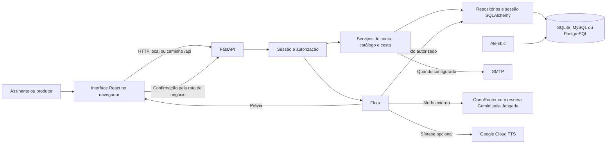

# Roadmap de arquitetura de ponta a ponta

O Cesta do Vale é o exemplo técnico. Este roadmap mostra como o sistema foi organizado e quais entregas e critérios usar no próximo projeto. O [passo a passo](PASSO_A_PASSO_PROJETO.md) executa as mesmas oito fases. A versão de referência e suas limitações estão no [estado técnico](ESTADO_ATUAL.md).

## 1. Mapa do sistema de referência

| Camada | Responsabilidade e arquivos na origem |
| --- | --- |
| Site público e área autenticada | `frontend/src/App.jsx` compõe navegação e estado. `componentes/` contém landing, acesso, catálogo, histórico, pedido e separação. `funcionalidades/assistente/` contém a interface da Flora, o cliente da funcionalidade e os controles de voz. |
| Fronteira HTTP | `frontend/src/api.js` envia requisições e credenciais. `backend/main.py` registra CORS e roteadores. `backend/rotas/` trata entradas, permissões e respostas. `backend/esquemas/` define contratos Pydantic. |
| Identidade e domínio | `backend/seguranca.py`, `backend/rotas/autenticacao.py` e `backend/servicos/permissoes.py` sustentam identidade e autorização. `backend/servicos/cesta.py` concentra regras de pedido, reserva, separação, envio e entrega. |
| Dados | `backend/banco.py` abre a sessão. Em `backend/`, os diretórios `repositorios/`, `modelos/` e `migracoes/` tratam persistência, entidades e mudanças de esquema. |
| Integrações | `backend/ia/` trata intenções, contexto e propostas. `backend/servicos/email_conta.py` e `backend/servicos/voz_flora.py` isolam integrações opcionais de conta e áudio. |
| Entrega e operação | Compose, Caddy e Dockerfiles descrevem o ambiente em contêineres. `frontend/vercel.json` configura o build e o proxy na Vercel. `.github/workflows/ci.yml` configura verificações automáticas. |

## 2. Jornadas e regras que atravessam as camadas

| Jornada | Caminho no Cesta do Vale | Decisão para o outro site |
| --- | --- | --- |
| Acesso | Cadastro público de assinante em `POST /usuarios`. Login por usuário ou e-mail em `POST /autenticacao/login`, restauração por `GET /usuarios/me` e recuperação por token de uso único. A API entrega JWT em cookie `HttpOnly` e em JSON. O frontend guarda a cópia em `sessionStorage` e a envia como Bearer. | Definir quais telas precisam de conta, como provisionar perfis internos, qual política de sessão adotar e o efeito esperado do logout. |
| Catálogo e pedido | `GET /produtos` obtém catálogo. Produtor cadastra e edita estoque, categoria e preço conforme a permissão. Assinante revisa a cesta e `POST /cestas` valida, calcula o valor com os dados do servidor e reserva estoque. O histórico preserva o preço unitário registrado na criação. | Definir o recurso do novo domínio, proprietário, limites, unidade, fonte de preço e invariantes de disponibilidade. |
| Separação e entrega | `Pendente` → `Em separação` → `Preparado para envio` → `Enviado` → `Entregue`. O produtor registra a separação, pode lidar com faltantes e marca o envio. A assinante acompanha, cancela quando elegível, confirma a entrega e avalia. O envio gera notificação persistida. | Definir estados, autor autorizado, pré-condições, efeitos colaterais, reabertura, repetição e concorrência. |
| Flora | Consultas reconhecidas em `/assistente/analisar` podem ser locais. A análise externa segue intérprete → especialista → QA → validação local. `/assistente/pedido` tem fluxo próprio para propor cesta e aceita rascunho. `/assistente/pedido/substituicao` valida a substituição. A proposta é revisada e a confirmação usa as rotas de negócio. | Decidir se IA é necessária, dados permitidos, contratos, confirmação explícita, integração opcional de voz e alternativa manual. |

**Modelo de dados de referência.** `usuarios` se relaciona com `cestas`, `tokens_conta` e `notificacoes`. Cada cesta tem `itens_cesta` e `separacoes` vinculados a `produtos`. Avaliações e marcos da separação e do envio ficam na cesta. As notificações vinculam conta e cesta. O novo esquema deve definir suas próprias chaves, constraints e política de retenção. [Diagrama de dados](02_REFERENCIAS/docs/banco-de-dados.md)

**Fronteiras de confiança.** O backend determina perfil e propriedade do registro, revalida o pedido após a prévia e mantém credenciais de banco, SMTP e IA no servidor. Se houver IA externa, envie o contexto mínimo autorizado e mantenha valores, estoque e gravação sob controle da aplicação. Na Flora, o modo padrão é simulado. Quando o modo externo está configurado, a Jangada pode usar Gemini em falhas elegíveis do OpenRouter. A montagem usa lista de ferramentas vazia. [Fluxo detalhado da Flora](FLORA_FLUXO_POSSIBILIDADES_E_TESTES.md)

## 3. Topologia, publicação e operação

| Ambiente | Arranjo de referência | Verificação para o novo projeto |
| --- | --- | --- |
| Desenvolvimento | Vite em `5173`, FastAPI em `8000`, SQLite para a execução local simples. | Subir tela e API com dados fictícios, conferir CORS, URL da API e origem do banco. |
| Compose | Caddy serve o build em `8080` por padrão, encaminha `/api` para `api:8000` e a API usa MySQL quando configurada para esse driver. O serviço da API aplica Alembic na inicialização. A carga de demonstração é uma ação separada. | Subir com banco novo e volume próprio, conferir migração, persistência após reinício e logs da API. |
| Homologação e produção | Vercel com frontend e API em projetos separados e proxy `/api`. Supabase é uma opção PostgreSQL. A autenticação permanece na API. | Definir domínio HTTPS, CI por ambiente, origem autorizada, configuração de sessão, segredos, banco separado e responsáveis por publicação e rollback. |

O `/health` da origem só confirma que a API responde. Inclua uma verificação de prontidão para as dependências necessárias e vincule publicação, monitoramento e recuperação aos critérios da fase 8.

## 4. Etapas, dependências e critérios de aceite

| Etapa | Depende de | Entrega | Critério para avançar |
| --- | --- | --- | --- |
| 1. Produto e protótipo | Tema e público | Objetivo, perfis, escopo, jornadas, mapa de telas e exemplos de erro/estado vazio. | A jornada principal pode ser explicada e demonstrada com dados fictícios. |
| 2. Fundação técnica | 1 | Repositório, estrutura, runtimes, ambiente isolado, CI inicial, mapa de implantação. | Serviços adotados sobem localmente e a CI roda com configuração própria. |
| 3. Dados e contratos, quando aplicável | 1–2 | Diagrama de dados, constraints, migrações, contrato HTTP e transições. | A migração sobe um banco vazio e, se houver versão anterior, atualiza seus dados. Contratos cobrem sucesso e falhas. |
| 4. Conta e permissões, quando aplicável | 2–3 | Cadastro ou provisionamento, login, recuperação, sessão e acesso por perfil e propriedade. | Testes verificam acesso permitido e negado, expiração, logout e recuperação. |
| 5. Jornada principal | 2 e fases 3–4 quando aplicáveis | Tela responsiva, operação principal, histórico, painel operacional e avisos quando cabíveis. | Jornada funciona de ponta a ponta com os serviços adotados. Operações persistentes preservam suas regras sob repetição e concorrência. |
| 6. Integrações opcionais | 5 | SMTP, voz e IA somente onde aprovados, com contratos, limites e alternativa manual. | Falha de provedor preserva o fluxo principal. Propostas exigem confirmação e passam pela validação de negócio. |
| 7. Homologação | 5 e 6 quando aplicável | Testes no navegador, integração, acessibilidade, privacidade e revisão de configuração. | Evidências em desktop e celular. Acesso por perfil, integrações e migrações conferidos quando aplicáveis. |
| 8. Lançamento e operação | 7 | Deploy, guias de operação, monitoramento, recuperação e responsáveis. | Jornada central conferida em HTTPS, alertas acionáveis e recuperação ensaiada em ambiente isolado. |

Use os [riscos identificados na origem](ESTADO_ATUAL.md#riscos-a-reavaliar-no-novo-projeto) para escolher critérios adicionais. Para cada fase do novo projeto, registre responsável, situação e evidência no [checklist](01_MODELOS/04_CHECKLIST_DE_CRIACAO.md).
