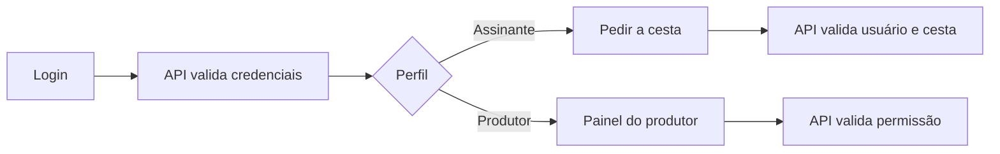

# Fluxos do sistema — Cesta do Vale

## 1. Fluxo de acesso

1. A página inicial oferece **Criar conta de assinante** e **Entrar**.
2. No cadastro público, a pessoa escolhe usuário e senha e informa o e-mail. A API cria exclusivamente uma conta de assinante. A interface confirma o cadastro e volta ao formulário de login. A confirmação do e-mail é opcional e o envio depende da configuração SMTP.
3. Novos produtores recebem um convite de um responsável autorizado. A pessoa abre o link, define e confirma a senha e vê a confirmação de ativação no formulário de login. O usuário e o e-mail são os definidos na emissão, e a conta fica inativa até a conclusão.
4. O login é comum aos dois perfis e aceita usuário ou e-mail e senha. Cada pessoa usa sua própria conta. A API identifica o perfil pela conta autenticada e a interface abre **Pedir a cesta** para assinantes ou o painel inicial do produtor.
5. **Esqueci minha senha** solicita o e-mail da conta. A API retorna uma resposta genérica e, quando aplicável, envia um link válido por 30 minutos e de uso único. A redefinição encerra as sessões anteriores e retorna ao login com a confirmação.
6. As rotas protegidas validam a sessão e as permissões. As contas existentes continuam usando o mesmo login.

O atalho **Entrar para usar a Flora** usa o mesmo formulário e abre o assistente após a autenticação.

### Emitir ou reenviar convite de produtor

No diretório `backend`, execute o comando com as dependências instaladas e as credenciais administrativas do banco do ambiente desejado. O exemplo usa o frontend local.

```powershell
python convidar_produtor.py horta-nova horta@example.com --url http://localhost:5173
```

- Em ambiente publicado, use a URL HTTPS do frontend. Se omitir `--url`, o comando usa `EMAIL_FRONTEND_URL`. A emissão dispensa SMTP.
- Envie o link retornado à pessoa convidada por um canal privado e informe o usuário ou e-mail reservado. Quem possui o link pode ativar a conta. O banco guarda só o hash do token.
- O convite vale 48 horas. Para reenviar um convite pendente, repita o comando com o mesmo usuário e e-mail. O link anterior em aberto expira na reemissão. O comando recusa conflitos com contas existentes.
- A API valida o link ao salvar a senha. Para um link inválido ou expirado, a pessoa pode pedir outro ao responsável. Se o link já foi usado, a mensagem orienta a entrar com a conta ativada.
- A emissão usa as tabelas `usuarios` e `tokens_conta` existentes. A ativação grava a senha e consome o convite na mesma transação. `criar_tabelas.py` continua sendo a carga para ambientes de demonstração.

## 2. Fluxo da assinante — criar pedido

1. Aline acessa **Pedir a cesta**.
2. Escolhe o tamanho da cesta.
3. Escolhe uma cesta pronta ou seleciona os produtos.
4. O sistema valida limite, estoque e quantidades.
5. Aline revisa a composição.
6. Confirma o pedido.
7. A cesta é criada como pendente e a confirmação aparece em **Minhas cestas**, com o pedido em destaque.

## 3. Fluxo da assinante — acompanhar pedido

1. Aline abre o histórico.
2. Seleciona uma cesta.
3. Consulta produtos, quantidades e situação.
4. Se estiver pendente, pode cancelar.
5. Após o envio, pode confirmar o recebimento.

## 4. Fluxo do produtor — separar pedido

1. Vanderlei acessa a área de separação pelo painel do produtor.
2. Consulta as cestas pendentes.
3. Abre uma cesta.
4. Registra os produtos separados, individualmente ou em lote.
5. Pode desfazer a última ação quando necessário.
6. Ao concluir todos os itens, finaliza a separação.
7. A cesta fica **Preparado para envio**.

## 5. Fluxo de autorização



## 6. Referências

- [`DIAGRAMA_GRUPOS.html`](DIAGRAMA_GRUPOS.html)
- [`../PASSO_A_PASSO_PROJETO.md`](../PASSO_A_PASSO_PROJETO.md)
- Telas em `frontend/src/componentes/`.
- [Mapa de telas e jornadas para o protótipo](../CRIACAO_NOVO_SISTEMA/03_EXEMPLOS/MAPA_DE_TELAS_CESTA_DO_VALE.md).
